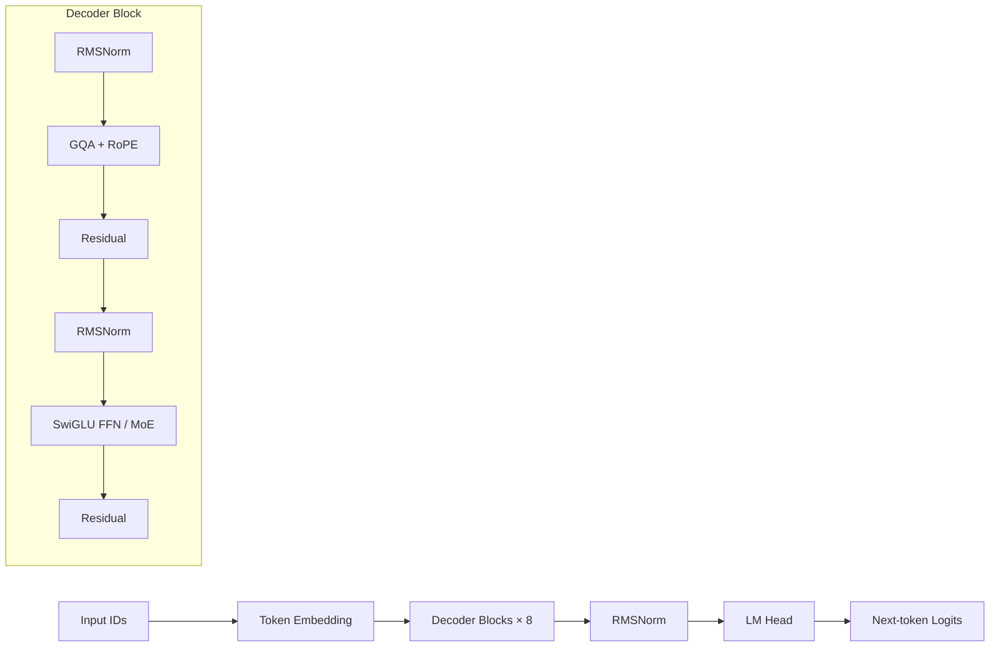

# MyMiniMind

> 一个面向学习与科研实践的小型语言模型项目：从 Transformer 核心结构实现出发，完成预训练、监督微调、数据加速、断点续训与交互式推理的完整闭环。

MyMiniMind 是一个基于 PyTorch 和 Hugging Face Transformers 构建的轻量级因果语言模型（Causal Language Model）。项目并非只调用封装好的训练接口，而是围绕语言模型的关键环节进行自主实现与工程化组织，包括注意力机制、位置编码、前馈网络、训练循环、对话标签构造、KV Cache 和采样解码等。

本项目希望以可阅读、可运行、可扩展的代码，探索小参数语言模型从“学习语言规律”到“遵循对话指令”的完整过程，并为后续研究 LoRA、MoE、长上下文和偏好对齐提供实验基础。

## 项目亮点

- **端到端训练闭环**：已打通文本预训练、全参数监督微调（SFT）、权重保存、断点续训和对话推理流程。
- **自主实现模型主体**：包含 RMSNorm、RoPE、YaRN、Grouped-Query Attention、SwiGLU 风格前馈网络及 Decoder-only Transformer Block。
- **高效推理支持**：实现 KV Cache 增量解码、Flash Attention、Top-k/Top-p 采样、Temperature 调节和重复惩罚。
- **面向对话的监督设计**：基于 Chat Template 构造多轮上下文，通过 assistant-only loss mask 只监督助手回复，避免对用户问题和系统提示计算损失。
- **大规模数据预处理优化**：使用多进程分词与 int16 memmap 预缓存约 90 万条 SFT 样本，减少训练期间重复模板渲染和 Tokenization 的 CPU 开销。
- **较完整的训练工程能力**：支持混合精度、梯度累积、梯度裁剪、余弦学习率调度、DDP 多卡训练、`torch.compile` 和原子化 checkpoint。
- **研究扩展接口**：模型支持可选 MoE 和 YaRN 长上下文外推，并提供 LoRA 注入、加载、保存与权重合并能力。

## 已完成工作

项目已完成两个主要训练阶段，并产出对应模型权重：

| 阶段 | 训练数据 | 主要目标 | 默认序列长度 | 产物 |
|---|---:|---|---:|---|
| Pretraining | 约 127 万条文本 | 学习语言建模与文本续写能力 | 340 | `pretrain_768.pth` |
| Full SFT | 约 91 万条多轮对话 | 学习聊天格式、指令理解与助手回复 | 768 | `full_sft_768.pth` |

默认稠密模型包含约 **63.9M 可学习参数**。仓库中的断点信息记录到了预训练与 SFT 的第 2 个 epoch 末，并保留了可用于继续训练的模型、优化器和混合精度状态。

## 模型结构

默认配置如下：

| 配置项 | 数值 |
|---|---:|
| Vocabulary Size | 6,400 |
| Hidden Size | 768 |
| Transformer Layers | 8 |
| Attention Heads | 8 |
| Key/Value Heads | 4 |
| Maximum Position Embeddings | 32,768 |
| Normalization | RMSNorm |
| Position Encoding | RoPE / YaRN |
| Activation | SiLU |
| Word Embedding | 与 LM Head 权重共享 |

模型采用 Pre-Norm Decoder-only 架构：



其中 GQA 使用较少的 KV Heads，在保留多头 Query 表达能力的同时降低 KV Cache 的存储与访存开销。模型还支持将普通前馈层切换为稀疏 MoE，通过 Top-k 路由选择参与计算的专家。

## 训练流程

```text
原始文本
   │
   ▼
Pretraining ── 学习 next-token prediction
   │
   ▼
预训练权重 pretrain_768.pth
   │
   ▼
Full SFT ── Chat Template + assistant-only loss
   │
   ▼
对话模型 full_sft_768.pth
   │
   ▼
KV Cache + Sampling 交互式生成
```

### 预训练

预训练数据采用 JSONL 格式，每行包含一段文本：

```json
{"text": "一段用于语言建模的文本……"}
```

文本被处理为 `BOS + tokens + EOS + PAD`。模型使用因果语言建模目标预测下一个 token，Padding 位置通过 `-100` 从交叉熵损失中屏蔽。

### 监督微调

SFT 数据使用多轮对话格式：

```json
{
  "conversations": [
    {"role": "user", "content": "什么是机器学习？"},
    {"role": "assistant", "content": "机器学习是……"}
  ]
}
```

Tokenizer 的 Chat Template 将 system、user、assistant 和工具调用消息统一编码。标签生成器只保留 assistant 回复及其结束标记，其余 token 均设为 `-100`。这一设计使模型在完整上下文条件下学习生成高质量助手回复。

## 数据预缓存

在线执行 Chat Template、Tokenizer 和标签定位会造成较明显的 CPU 开销。为提升训练数据供给效率，本项目实现了专用的 SFT 预缓存流程：

1. 多进程并行处理原始对话；
2. 预先生成定长 `input_ids` 与 `labels`；
3. 使用 int16 memmap 直接写入磁盘；
4. 训练时按需映射并转换为 PyTorch Tensor。

当前缓存包含约 `905718 × 768` 个 token 位置。词表 ID 与标签屏蔽值 `-100` 均位于 int16 范围内，因此可在不损失信息的前提下降低存储成本，并避免每个 epoch 重复执行 CPU 密集型处理。

## 训练工程设计

训练脚本没有依赖 Hugging Face Trainer，而是使用原生 PyTorch 编写，以便清晰控制训练过程：

- AdamW 优化器；
- Cosine Learning Rate Decay；
- BF16/FP16 自动混合精度；
- Gradient Accumulation 与 Gradient Clipping；
- DistributedDataParallel 多卡训练；
- 可选 `torch.compile` 图编译；
- 定期保存半精度推理权重；
- 保存模型、优化器和 GradScaler 状态以支持断点续训；
- 临时文件写入完成后原子替换，降低 checkpoint 损坏风险；
- 可选 SwanLab 实验指标记录。

## 快速开始

### 1. 环境配置

推荐使用 Python 3.11 和 [uv](https://docs.astral.sh/uv/) 管理环境：

```bash
uv sync --extra gpu
```

仅进行 CPU 端代码阅读或数据处理时，可以执行：

```bash
uv sync
```

### 2. 预训练

训练脚本的默认数据与输出路径以 `trainer/` 为基准：

```bash
cd trainer
uv run python train_pretrain.py \
  --hidden_size 768 \
  --num_hidden_layers 8 \
  --epochs 2 \
  --batch_size 32 \
  --accumulation_steps 8
```

多卡训练可以使用 `torchrun`：

```bash
cd trainer
uv run torchrun --nproc_per_node=2 train_pretrain.py
```

### 3. 全参数 SFT

SFT 默认从 `pretrain_768.pth` 加载基础权重：

```bash
cd trainer
uv run python train_full_sft.py \
  --hidden_size 768 \
  --num_hidden_layers 8 \
  --epochs 2 \
  --batch_size 16 \
  --cache_data
```

第一次添加 `--cache_data` 时会自动建立预分词缓存，后续训练可直接复用。

### 4. 断点续训

```bash
cd trainer
uv run python train_full_sft.py --from_resume 1 --cache_data
```

脚本会恢复模型、优化器、训练轮次、step 和 GradScaler 状态；当 GPU 数量变化时，也会按照 world size 调整续训 step。

### 5. 交互式推理

返回项目根目录并运行：

```bash
uv run python eval_llm.py \
  --weight full_sft \
  --max_new_tokens 512 \
  --historys 4
```

程序提供自动测试与手动输入两种模式，并通过 TextStreamer 实时输出生成内容和解码速度。

## 项目结构

```text
myMinimind/
├── model/
│   ├── model_myminimind.py    # 模型配置、Transformer、MoE 与生成逻辑
│   ├── model_lora.py          # LoRA 注入、保存、加载与合并
│   ├── tokenizer.json
│   └── tokenizer_config.json
├── dataset/
│   ├── lm_dataset.py          # Pretrain/SFT Dataset 与预缓存实现
│   ├── pretrain_t2t_mini.jsonl
│   └── sft_t2t_mini.jsonl
├── trainer/
│   ├── train_pretrain.py      # 预训练入口
│   ├── train_full_sft.py      # 全参数 SFT 入口
│   └── trainer_utils.py       # DDP、学习率、checkpoint 等工具
├── notes/                     # 核心代码与训练机制的中文笔记
├── checkpoints/               # 可恢复训练状态
├── out/                       # 推理模型权重
├── eval_llm.py                # 交互式推理评测
└── pyproject.toml             # 项目依赖与环境配置
```

## 研究与实践价值

与直接微调现成大模型相比，本项目更关注语言模型内部机制和完整训练过程。通过控制模型规模，可以在有限算力下观察数据构造、损失设计、优化策略和推理解码之间的关系，使理论学习能够对应到可执行代码与真实训练产物。

项目覆盖了本科阶段开展大模型研究时较具代表性的几个问题：

- Transformer 各组件如何协同完成自回归语言建模；
- 预训练与指令微调的目标函数有何差异；
- 如何构造多轮对话监督信号并避免学习用户输入；
- 如何平衡训练吞吐、内存占用与实现复杂度；
- 如何通过 GQA、KV Cache 和 Flash Attention 优化生成效率；
- 如何建立能够继续扩展至参数高效微调和偏好对齐的代码基础。

## 后续计划

- 增加独立验证集与 Perplexity、生成质量等评测指标；
- 保存训练指标并绘制 Loss、Learning Rate、吞吐和显存曲线；
- 补充完整的 LoRA SFT 训练入口与对比实验；
- 探索 DPO/GRPO 等偏好优化方法；
- 对比不同 GQA、MoE 和上下文长度配置的计算效率与模型表现；
- 完善单元测试、配置管理和 Hugging Face 格式导出。

## 说明

MyMiniMind 是一个以学习、实验和科研实践为目标的个人项目。项目重视代码可读性与关键机制的自主实现，适合用于理解小型语言模型训练流程、验证新想法，以及作为更深入语言模型研究的起点。
